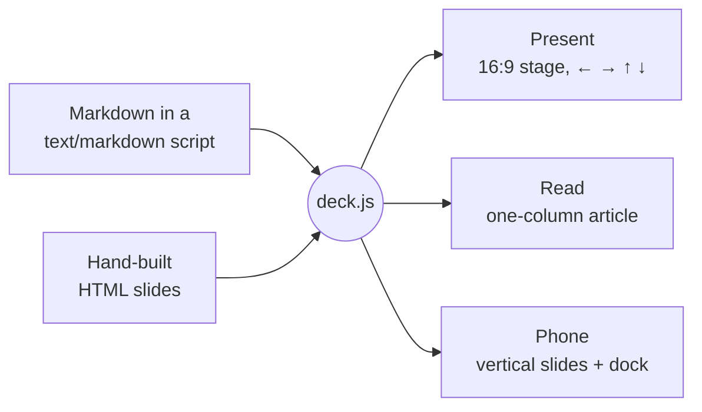

<div align="center">


# deckkit

**Write slides in Markdown. Present them on a stage. Send the same link to a phone and it reads like an essay.**

Two files · No build step · 23 themes, light and dark · MIT

[**Live demo**](https://sambhav.dev/deckkit/) &nbsp;·&nbsp; [Quick start](#-quick-start) &nbsp;·&nbsp; [Syntax](#-writing-slides) &nbsp;·&nbsp; [Widgets](#-widgets) &nbsp;·&nbsp; [Themes](#-themes) &nbsp;·&nbsp; [API](#-api)

    

<br>


</div>

<br>

## Why deckkit?

Most slides only make sense while someone is presenting them. Send a deck to someone who missed the talk and they get the bullet points without the reasoning behind them.

deckkit keeps your speaker notes in the deck. Present it and the notes stay with you; open the same link later and they become the text between the slides. One file works in three places:

| | On a laptop | On a phone | In a review |
|---|---|---|---|
| **You get** | A 16:9 stage, driven from the keyboard | A scrolling article, with your notes as the prose | One Markdown file, so changes are a normal diff |

And it stays out of your way: no install, no bundler, no framework. Link two files, write Markdown, open the page.

## ✨ Features

- **Markdown first.** `---` between slides, `<!-- comments -->` for speaker notes, `|||` for columns.
- **Steps built into navigation.** ← → change slides; ↑ ↓ walk the steps on a slide and then carry on, so a presenter can just keep pressing ↓.
- **Read view.** Phones open the deck as an article: slides reflow, builds show finished, notes become paragraphs.
- **Interactive widgets in plain Markdown.** Tabs, walkthroughs, explained tables, stepped code, flip cards, timelines, stats, callouts and Mermaid diagrams.
- **23 themes**, each a designed light/dark pair with its own typefaces, checked for WCAG AA contrast.
- **Syntax highlighting and diagrams** that follow the theme, loaded only when a deck needs them.
- **An HTML escape hatch** for the one slide that needs a hand-built, animated diagram.
- **Deep links** to any slide and step: `#5.3`, or `#pricing` by id.

## 🚀 Quick start

Create `talk.html`:

```html
<!DOCTYPE html>
<html lang="en">
<head>
  <meta charset="utf-8">
  <meta name="viewport" content="width=device-width, initial-scale=1">
  <title>Dynamic Tools</title>
  <link rel="stylesheet" href="https://cdn.jsdelivr.net/gh/sambhav/deckkit@main/deck.css">
  <script src="https://cdn.jsdelivr.net/gh/sambhav/deckkit@main/deck.js"></script>
</head>
<body>
<script type="text/markdown">
layout: title
---
# Dynamic Tools

What happens when the tool you need arrives halfway through.

September 2026 · 15 minutes {.meta}

<!-- Speaker notes go in comments. In read view they become the text under the slide. -->

---
## One idea per slide

- Big type
- Short lines
- Press ↓ to step, → to move on
</script>
</body>
</html>
```

Open it in a browser and press →. That's it.

<details>
<summary><b>Prefer to self-host?</b></summary>

<br>

Copy [`deck.css`](deck.css) and [`deck.js`](deck.js) next to your HTML and link them directly. [`examples/starter.html`](examples/starter.html) is a ready-made starting point. To publish, put the folder anywhere that serves static files: GitHub Pages, a bucket, an intranet share.

</details>

## 🧭 How it works



`deck.js` turns each Markdown script into ordinary `<section class="slide">` elements, next to any you wrote by hand. Present view scales them onto a 1280×720 stage. Read view lays the same elements out as an article, so nothing is rendered twice. Widgets register as **steppers**: ↓ advances the first unfinished stepper on the slide, then moves to the next slide.

## ✍️ Writing slides

```md
---
kicker: Results
build: true
---
## Latency fell by half

|||

- p50: 180 ms → 90 ms
- p99: 1.2 s → 480 ms {.step}

|||

::: card
**What changed:** the cache moved to the edge.
:::

<!-- Walk through p50 first, then reveal p99. -->
```

| Syntax | Effect |
|---|---|
| `---` | Starts a new slide |
| `key: value` lines between two `---` | Frontmatter for the next slide |
| `<!-- … -->` | Speaker notes |
| `\|\|\|` | Starts a column. Text before the first one spans the slide |
| `::: name` … `:::` | Wraps blocks in `<div class="name">`. Containers nest. `::: grid` makes balanced rows |
| `{.step}` | Reveals that block on ↓ |
| `{.class #id}` | Adds a class or id. On its own line, applies to the block above |
| `==text==` | Accent-coloured text |
| `[text](#id)` | Links to the slide with that `id` |
| `::: present-only` · `::: read-only` | Content for one view only. `{.present-only}` or `{.read-only}` works on a single block, and the classes work in HTML slides too |

Everything else is ordinary Markdown, and inline HTML passes through. Inside a Markdown script, write `<\/script>` for a literal closing script tag.

<details>
<summary><b>Frontmatter keys</b></summary>

<br>

| Key | Values |
|---|---|
| `layout` | `title`, `section`, `statement`, `center` or `default` |
| `section` | Shown in the top bar. It carries over until changed; a `section` slide sets it to its heading |
| `kicker` | A small label above the heading |
| `build` | `true` reveals each block after the heading, and each list item, one step at a time |
| `id` | A name for deep links (`#id`) and slide links (`[text](#id)`) |
| `class` | Extra classes on the slide |
| `name` | The slide's name in the overview. Defaults to its first heading |
| `takeaway` | One line shown above the speaker notes |

</details>

## 🧩 Widgets


Each widget is a few lines of Markdown. Each one takes part in ↑ ↓ navigation, and in read view each shows all of its content.

| Widget | Write |
|---|---|
| **Tabs** | `::: tabs`, then a `###` heading per tab. `::: toggle` is the same, styled as a switch |
| **Walkthrough** | `::: steps`, then a `###` heading per step. Adds a counter, progress dots and Next |
| **Explained table** | `{.explain}` after a table. The last column becomes the detail for the selected row |
| **Marks** | ✓ ◐ ✗ at the start of a cell become icons in the theme's green, accent and red |
| **Stepped code** | ` ```python {steps: 1-2 \| 3-4} ` lights up each group of lines in turn |
| **Flip cards** | `::: flip`: the `###` heading is the front, the rest is the back |
| **Timeline** | `::: timeline`, then a `###` heading per milestone. Vertical on phones |
| **Stats** | `::: stats` around a list like `- **42%** faster first response` |
| **Callouts** | `> [!NOTE]`, `[!TIP]`, `[!WARNING]`, `[!IMPORTANT]`, `[!CAUTION]` |
| **Diagrams** | ` ```mermaid `: flowcharts, networks, sequence, architecture, state, charts and more. Add `{source}` to show the text beside it |

```md
::: tabs
### Present
The 16:9 stage, scaled to the screen.
### Read
One column. Notes become the prose.
:::
```

<details>
<summary><b>Code highlighting and diagrams</b></summary>

<br>

Fenced code is highlighted by [highlight.js](https://highlightjs.org/), and [Mermaid](https://mermaid.js.org/) draws diagrams. Both use the theme's colours and fonts, and redraw when the theme or mode changes. Each library is fetched from jsDelivr only if the deck needs it. To self-host one or turn it off:

```html
<html data-highlight="/vendor/highlight.min.js" data-diagrams="off">
```

With diagrams off, or offline, the Mermaid source is shown instead.

</details>

## 🎨 Themes


One attribute picks the look:

```html
<html lang="en" data-theme="rose">
```

| | |
|---|---|
| **Everyday** | `paper` (default) · `clean` · `slate` · `ledger` · `noir` ☾ |
| **Editorial & craft** | `editorial` · `swiss` · `atelier` · `mocha` |
| **Warm & friendly** | `rose` · `sunset` · `chalk` ☾ · `clinic` |
| **Nature & calm** | `forest` · `ocean` · `nord` ☾ |
| **Tech** | `solar` ☾ · `terminal` ☾ · `ai` ☾ · `blueprint` ☾ |
| **Loud** | `punk` · `volt` ☾ · `synth` ☾ |

Every theme is a light and dark pair; ☾ marks the ones designed dark first, and the picker shows the same mark. The mode follows the system until someone presses **T**, and the choice is remembered.

- `?theme=rose` and `?mode=dark` in the URL override both. Handy for sharing.
- `<html data-theme-picker>` adds a picker to the top bar so viewers can choose.
- Typefaces load from Google Fonts for the active theme only. `<html data-fonts="off">` keeps system fonts.

<details>
<summary><b>Make your own</b></summary>

<br>

Every colour, typeface and size is a CSS custom property. Override them after `deck.css`:

```css
:root {
  --accent: #F1B000; --accent-soft: #FFF3CC; --on-accent: #161514; --accent-ink: #8D6700;
  --sans: "Space Grotesk", system-ui, sans-serif;
}
[data-mode=dark] { --accent: #FFC94D; --accent-ink: #F5C542; }
```

| Token | Use |
|---|---|
| `--bg` `--surface` `--surface-2` `--line` | Background, cards, insets, hairlines |
| `--fg` `--muted` | Text and secondary text |
| `--faint` | Decorative lines and dots, never text |
| `--accent` `--accent-soft` `--on-accent` | Accent, its tint, and text on an accent fill |
| `--accent-ink` | The accent as text: links, kickers, highlights |
| `--inv` `--on-inv` `--inv-muted` | Inverted blocks (`.card.inv`) and their text |
| `--red` `--green` `--blue` `--orange` | Status colours, used by callouts, marks and diagrams |
| `--mark-yes` `--mark-part` `--mark-no` | ✓ ◐ ✗ colours |
| `--c-key` `--c-str` `--c-com` `--c-num` `--c-fn` `--c-type` `--c-tag` | Code highlighting |
| `--sans` `--display` `--mono` | Body, heading and mono typefaces |
| `--grid` | A colour draws a background grid; `transparent` turns it off |
| `--t-title` `--t-h2` `--t-body` … | The type scale. Read view and phone slides redefine it |

</details>

## 🎤 Presenting

| Key | |
|---|---|
| `←` `→` `Space` | Previous / next slide |
| `↑` `↓` `Enter` | Previous / next step, then on to the next slide |
| `1`–`9` | Jump to a step on this slide |
| `R` | Read view ⇄ present view |
| `T` | Light ⇄ dark |
| `O` · `N` · `F` · `?` | Overview · speaker notes · fullscreen · all keys |

On touch screens a dock replaces the keyboard, with buttons for back, next, notes and read view, and you can swipe between slides and steps.

## 📱 Reading


Phones and portrait tablets open in **read view**, and on a laptop **R** switches to it:

- Markdown slides reflow into article typography, with a chapter label on each.
- **Speaker notes become the prose.** Timing cues like `[~60s]` are dropped.
- Builds and widgets show everything.
- Hand-built slides become figures with a **Present** button.

Present view works on phones too. Held upright, slides go vertical and reflow at the phone's width, and speaker notes hide until you tap the notes button. Force a view with `?view=read` or `?view=present`.

## 🛠 HTML slides

When a slide needs something Markdown can't express, write it by hand, anywhere between Markdown blocks:

```html
<section class="slide" data-section="Architecture" data-name="The pipeline">
  <div class="content">
    <h2>How a request flows</h2>
    <div id="pipe">…</div>
    <button data-next></button>
  </div>
  <aside class="notes">What to say over this slide.</aside>
</section>

<script>
  Deck.steps(document.getElementById('pipe'), 4, i => {
    // draw step i; ↑ ↓, the step counter and the URL all follow along
  }, { read: 'end' });   // show the last step in read view
</script>
```

Add the class `flow` if the slide can reflow in read view; otherwise it is shown as a scaled figure. A slide can have several steppers. `<div data-build>` with `[data-step]` children and `<button data-next>` work without any script.

## 📚 API

| | |
|---|---|
| `Deck.steps(el, n, show, { read })` | Register a stepper. `show(i)` renders step `i` |
| `Deck.tabs(container, onPick)` | Make each button in a container a step |
| `Deck.go(i, step?)` · `Deck.next()` · `Deck.prev()` | Move the deck |
| `Deck.cur` · `Deck.slide` · `Deck.slides` | Current index, current slide, all slides |
| `Deck.on('slide', (slide, i) => …)` | Runs when the slide changes |
| `Deck.on('ready', () => …)` | Runs once Markdown slides exist |
| `Deck.key('d', e => …)` | Bind a key |
| `Deck.setView('read' \| 'present')` | Switch views |
| `Deck.markdown(text)` | Render Markdown to HTML |
| `Deck.store.get(k, fallback)` · `.set(k, v)` | localStorage, namespaced `deckkit:` |

## 🌐 Browser support

Current Chrome, Edge, Firefox and Safari, on desktop and mobile. Print from the browser for a PDF with one slide per page and every build shown.

## 🤝 Contributing

Issues and pull requests are welcome. There's no toolchain: edit `deck.js` or `deck.css`, then open [`index.html`](index.html), which is the demo deck and the best test page. Before sending a change, check present view, read view (**R**), dark mode (**T**) and a phone-sized window.

deckkit is pre-release (0.1.0), so the syntax may still change before 1.0.

## License

[MIT](LICENSE) © Sambhav Kothari
