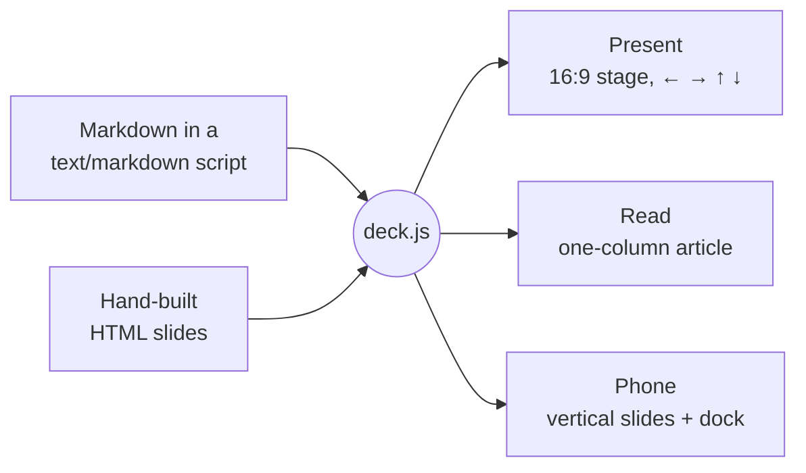

<div align="center">


# talkdown

**An agent-first slide format. Your agent writes a short Markdown file; you present it as slides, and everyone else reads it as an article.**

One file · Instant preview · No build · Host on GitHub Pages

[**Live demo**](https://sambhav.dev/talkdown/) &nbsp;·&nbsp; [Quick start](#-quick-start) &nbsp;·&nbsp; [For agents](#-for-agents) &nbsp;·&nbsp; [Syntax](#-writing-slides) &nbsp;·&nbsp; [Widgets](#-widgets) &nbsp;·&nbsp; [Themes](#-themes) &nbsp;·&nbsp; [API](#-api)

    

<br>


</div>

<br>

## Why talkdown?

Asking an agent for an HTML deck works, and the result looks great. But every slide costs a lot of tokens, and once it exists you can't change a heading or reorder two slides without asking the model again.

talkdown is a small Markdown format. An agent writes a deck in a fraction of the tokens, and you can open the file and fix it by hand. The same file serves two audiences:

| | Presenting | Not there |
|---|---|---|
| **They get** | A 16:9 stage, driven from the keyboard | A scrolling article, with your speaker notes as the prose |
| **You control** | `<!-- say: … -->`, `::: present-only` | `<!-- read: … -->`, `::: read-only` |

It also stays out of your way: no install, no bundler, no framework. Write one file, open it, refresh to preview, and push it to GitHub Pages.

## ✨ Features

- **Markdown first.** `---` between slides, `<!-- comments -->` for speaker notes, `|||` for columns.
- **Steps built into navigation.** ← → change slides; ↑ ↓ walk the steps on a slide and then carry on, so a presenter can just keep pressing ↓.
- **Two formats from one file.** Present as slides; the same link reads as an article, and you control each format separately.
- **Read view.** Phones open the deck as an article: slides reflow, builds show finished, notes become paragraphs.
- **Interactive widgets in plain Markdown.** Tabs, walkthroughs, explained tables, stepped code, flip cards, timelines, stats, callouts, charts, pull quotes, checklists, footnotes, maths and Mermaid diagrams.
- **23 themes**, each a designed light/dark pair with its own typefaces, checked for WCAG AA contrast.
- **Syntax highlighting and diagrams** that follow the theme, loaded only when a deck needs them.
- **An HTML escape hatch** for the one slide that needs a hand-built, animated diagram.
- **Deep links** to any slide and step: `#5.3`, or `#pricing` by id.

## 🚀 Quick start

Create `talk.html`:

```html
<!DOCTYPE html>
<html lang="en">
<head>
  <meta charset="utf-8">
  <meta name="viewport" content="width=device-width, initial-scale=1">
  <title>Dynamic Tools</title>
  <link rel="stylesheet" href="https://cdn.jsdelivr.net/gh/sambhav/talkdown@main/dist/deck.css">
  <script src="https://cdn.jsdelivr.net/gh/sambhav/talkdown@main/dist/deck.js"></script>
</head>
<body>
<script type="text/markdown">
layout: title
---
# Dynamic Tools

What happens when the tool you need arrives halfway through.

September 2026 · 15 minutes {.meta}

<!-- Notes go in comments. In read view they become the text under the slide. -->

---
## One idea per slide

- Big type
- Short lines
- Press ↓ to step, → to move on
</script>
</body>
</html>
```

Open it in a browser and press →. That's it.

<details>
<summary><b>Prefer to self-host?</b></summary>

<br>

Copy [`dist/deck.css`](dist/deck.css) and [`dist/deck.js`](dist/deck.js) next to your HTML and link them directly. [`examples/starter.html`](examples/starter.html) is a ready-made starting point. To publish, put the folder anywhere that serves static files: GitHub Pages, a bucket, an intranet share.

</details>

## 🤖 For agents

Give your agent one URL and it learns the whole format:

```
https://sambhav.dev/talkdown/skills/talkdown/SKILL.md
```

The same file is on the CDN at `https://cdn.jsdelivr.net/gh/sambhav/talkdown@main/skills/talkdown/SKILL.md`, and [`llms.txt`](https://sambhav.dev/talkdown/llms.txt) is the short index for tools that look for one.

A prompt that works:

> Read https://sambhav.dev/talkdown/skills/talkdown/SKILL.md and make me a 10-slide talkdown deck about how our cache invalidation works. Put what you'd say in speaker notes so it also reads as an article.

**In Claude Code**, copy the [`skills/talkdown`](skills/talkdown) folder into `~/.claude/skills/` (or a project's `.claude/skills/`) and ask for a talkdown deck. It loads when needed.

## 🧭 How it works



`deck.js` turns each Markdown script into ordinary `<section class="slide">` elements, next to any you wrote by hand. Present view scales them onto a 1280×720 stage. Read view lays the same elements out as an article, so nothing is rendered twice. Widgets register as **steppers**: ↓ advances the first unfinished stepper on the slide, then moves to the next slide.

## ✍️ Writing slides

```md
---
kicker: Results
build: true
---
## Latency fell by half

|||

- p50: 180 ms → 90 ms
- p99: 1.2 s → 480 ms {.step}

|||

::: card
**What changed:** the cache moved to the edge.
:::

<!-- Walk through p50 first, then reveal p99. -->
```

| Syntax | Effect |
|---|---|
| `---` | Starts a new slide |
| `key: value` lines between two `---` | Frontmatter for the next slide |
| `<!-- … -->` | Notes: spoken when presenting, and the prose in the article. `<!-- say: … -->` is speaker-only, `<!-- read: … -->` article-only |
| `\|\|\|` | Starts a column. Text before the first one spans the slide |
| `::: name` … `:::` | Wraps blocks in `<div class="name">`. Containers nest. `::: grid` makes balanced rows |
| `{.step}` | Reveals that block on ↓ |
| `{.class #id}` | Adds a class or id. On its own line, applies to the block above |
| `==text==` | Accent-coloured text |
| `[text](#id)` | Links to the slide with that `id` |
| `::: present-only` · `::: read-only` | Content for one format only. See [One deck, two formats](#one-deck-two-formats) |

Markdown is tokenized by bundled markdown-it, with talkdown extensions for slides, containers, notes, and widgets. `---` is reserved for slide boundaries, so use `#` headings rather than Setext underlines. Inline HTML passes through; decks should contain trusted author content.

### One HTML file, no author build

The existing single-file workflow stays supported: put your content in `index.html`, link `deck.js` and `deck.css`, and open it. No install, build, or separate Markdown file is required. Local copies of the script and stylesheet also work from `file://`.

For a single self-contained HTML file, write `<\/script>` instead of a literal closing script tag inside the Markdown script. **S → Copy** preserves that escape so the result can be pasted back into the HTML safely.

Markdown, CSV data, HTML slides and custom JavaScript can all stay in that one HTML file. The tokenizer and CSV decoder are already bundled into `deck.js`; no additional script tags or per-deck generated files are needed.

Published assets live in `dist/`; editable code and styles live in `src/`. The old root `deck.js` and `deck.css` URLs remain supported for existing CDN and sambhav.dev embeds. The build generates byte-identical compatibility copies, so old URLs keep the same loading behavior.

To reference a Markdown file instead of embedding it, use:

```html
<script type="text/markdown" data-src="talk.md"></script>
```

Serve referenced decks over HTTP; direct `file://` use remains supported for inline decks. You can mix references, inline Markdown, and hand-written HTML slides in document order. Relative image and recording URLs resolve against the HTML wrapper. A failed reference displays an error without preventing the other slides from loading.

- Escape punctuation in prose with a backslash: `\*literal asterisks\*`.
- Use two backticks around inline code that contains one backtick, and a longer matching fence around fenced code examples.
- Pipes inside code spans stay within one table cell; use `\|` for a literal pipe elsewhere in a table.
- Fenced code preserves comments, footnote definitions, slide separators, and widget delimiters as literal examples.

<details>
<summary><b>Frontmatter keys</b></summary>

<br>

| Key | Values |
|---|---|
| `layout` | `title`, `section`, `statement`, `center` or `default` |
| `section` | Shown in the top bar. It carries over until changed; a `section` slide sets it to its heading |
| `kicker` | A small label above the heading |
| `build` | `true` reveals each block after the heading, and each list item, one step at a time |
| `id` | A name for deep links (`#id`) and slide links (`[text](#id)`) |
| `class` | Extra classes on the slide |
| `name` | The slide's name in the overview. Defaults to its first heading |
| `takeaway` | One line shown above the speaker notes |
| `read` | `hide` leaves the slide out of the article. `text` shows only its prose in the article, not the slide |
| `present` | `hide` makes an article-only slide: skipped when presenting |
| `image` | A background picture. With `layout: image`, the text sits over it on a dark scrim |

</details>

## 🧩 Widgets


Each widget is a few lines of Markdown. Each one takes part in ↑ ↓ navigation, and in read view each shows all of its content.

| Widget | Write |
|---|---|
| **Tabs** | `::: tabs`, then a `###` heading per tab. `::: toggle` is the same, styled as a switch |
| **Walkthrough** | `::: steps`, then a `###` heading per step. Adds a counter, progress dots and Next |
| **Explained table** | `{.explain}` after a table. The last column becomes the detail for the selected row |
| **Marks** | ✓ ◐ ✗ at the start of a cell become icons in the theme's green, accent and red |
| **Stepped code** | ` ```python {steps: 1-2 \| 3-4} ` lights up each group of lines in turn |
| **Flip cards** | `::: flip`: the `###` heading is the front, the rest is the back |
| **Timeline** | `::: timeline`, then a `###` heading per milestone. Vertical on phones |
| **Stats** | `::: stats` around a list like `- **42%** faster first response` |
| **Callouts** | `> [!NOTE]`, `[!TIP]`, `[!WARNING]`, `[!IMPORTANT]`, `[!CAUTION]` |
| **Diagrams** | ` ```mermaid `: flowcharts, networks, sequence, architecture, state, charts and more. Add `{source}` to show the text beside it |
| **Charts** | `::: chart type=line view=both` around a table or fenced CSV. Plot, table and download share one dataset. Legacy `{.chart}` table attributes still work |
| **Pull quotes** | A `>` quote whose last line starts with `—` becomes a large quote with that attribution |
| **Checklists** | `- [x] done` and `- [ ] to do` |
| **Footnotes** | `text[^1]` and a `[^1]: source` line anywhere on the slide; set small at its foot |
| **Maths** | `$x^2$` inline or a `$$ … $$` block, typeset by [KaTeX](https://katex.org/) |
| **Image slides** | `layout: image` and `image: path.jpg` in the frontmatter: a full-bleed picture with the text over it |
| **Terminal** | A ` ```terminal ` block: each `$ command` line types out on ↓, and the lines after it are its output |
| **Recordings** | `` plays an [asciinema](https://asciinema.org/) recording in the same window, without the asciinema player. A file needs the page served over http; paste the recording into a ` ```cast ` block to play it anywhere |
| **Video** | `` embeds a player |
| **Accordion** | `::: accordion`, then a `###` heading per item; ↓ opens them in turn |
| **Feature cards** | `::: features`, then a `###` heading per card. An `:icon:` or image at the start of the heading becomes its icon |
| **Agenda** | An empty `::: agenda` lists every section slide, each linking to it |
| **QR code** | `::: qr` draws a QR code of the deck's link, or of a URL written inside it |
| **Icons** | `:rocket:` anywhere: any of the [Lucide](https://lucide.dev/icons) icons, drawn in the theme's colours. A feature card's heading can also start with `` |

```md
::: tabs
### Present
The 16:9 stage, scaled to the screen.
### Read
One column. Notes become the prose.
:::
```

<details>
<summary><b>Code highlighting, diagrams and maths</b></summary>

<br>

Fenced code is highlighted by [highlight.js](https://highlightjs.org/), [Mermaid](https://mermaid.js.org/) draws diagrams, and [KaTeX](https://katex.org/) typesets maths. Both use the theme's colours and fonts, and redraw when the theme or mode changes. Each library, and the QR code generator, and icons, is fetched from jsDelivr only if the deck needs it. To self-host one or turn it off:

```html
<html data-highlight="/vendor/highlight.min.js" data-diagrams="off" data-math="off">
```

With diagrams off, or offline, the Mermaid source is shown instead.

</details>

### Charts, data tables and CSV

````md
::: chart type=line view=both title="Median latency (ms)"
```csv
Quarter,Before,After
Q1,180,90
Q2,160,80
Q3,140,70
```
:::
````

You can put a Markdown table inside the container instead of CSV. The first column contains labels; remaining columns contain numeric series. CSV supports quoted commas, doubled quotes, multiline cells, BOM, LF and CRLF. Numeric cells accept decimals and scientific notation; missing values, currency symbols and percentages produce visible row/column errors instead of silently becoming zero. Keep units in the title. Bar, horizontal bar and line charts support signed values. Donuts require nonnegative values with a positive total; choose `series="After"` when the input has multiple numeric columns.

| Option | Values |
|---|---|
| `type` | `bar` (default), `hbar`, `line`, `donut` |
| `view` | `chart`, `table`, `both`, `auto` (default: chart when presenting, both in the article) |
| `title` | A quoted caption, such as `title="Median latency (ms)"` |
| `series` | Plot one named numeric column |

Every chart has a keyboard-accessible view selector and a **Download CSV** button. Explicit `view=both` puts the chart and table side by side on desktop slides and stacks them on phones. Data tables scroll within the widget; the first 200 rows are displayed and the download includes every row. Charts accept up to 1,000 rows and 50 numeric columns, with up to six plotted series. Invalid data remains inspectable. Formula-like text is escaped in CSV downloads for spreadsheet safety.

Native HTML uses the same component:

```html
<figure data-chart="line" data-chart-view="both">
  <figcaption>Median latency (ms)</figcaption>
  <table>
    <thead><tr><th>Quarter</th><th>Before</th><th>After</th></tr></thead>
    <tbody><tr><th>Q1</th><td>180</td><td>90</td></tr></tbody>
  </table>
</figure>
```

Place it inside a slide's `.content`. The native table remains useful before enhancement; `Deck.chart(element)` can enhance a chart added later by custom JavaScript.

## 🎨 Themes


One attribute picks the look:

```html
<html lang="en" data-theme="rose">
```

| | |
|---|---|
| **Everyday** | `clean` (default) · `paper` · `slate` · `ledger` · `noir` ☾ |
| **Editorial & craft** | `editorial` · `swiss` · `atelier` · `mocha` |
| **Warm & friendly** | `rose` · `sunset` · `chalk` ☾ · `clinic` |
| **Nature & calm** | `forest` · `ocean` · `nord` ☾ |
| **Tech** | `solar` ☾ · `terminal` ☾ · `ai` ☾ · `blueprint` ☾ |
| **Loud** | `punk` · `volt` ☾ · `synth` ☾ |

Every theme is a light and dark pair; ☾ marks the ones designed dark first, and the picker shows the same mark. Decks open in dark mode; `<html data-mode="light">` makes light the default. Viewers switch with **T**, and their choice is remembered.

- `?theme=rose` and `?mode=dark` in the URL override both. Handy for sharing.
- `<html data-theme-picker>` adds a picker to the top bar so viewers can choose.
- Typefaces load from Google Fonts for the active theme only. `<html data-fonts="off">` keeps system fonts.

<details>
<summary><b>Make your own</b></summary>

<br>

Every colour, typeface and size is a CSS custom property. Override them after `deck.css`:

```css
:root {
  --accent: #F1B000; --accent-soft: #FFF3CC; --on-accent: #161514; --accent-ink: #8D6700;
  --sans: "Space Grotesk", system-ui, sans-serif;
}
[data-mode=dark] { --accent: #FFC94D; --accent-ink: #F5C542; }
```

| Token | Use |
|---|---|
| `--bg` `--surface` `--surface-2` `--line` | Background, cards, insets, hairlines |
| `--fg` `--muted` | Text and secondary text |
| `--faint` | Decorative lines and dots, never text |
| `--accent` `--accent-soft` `--on-accent` | Accent, its tint, and text on an accent fill |
| `--accent-ink` | The accent as text: links, kickers, highlights |
| `--inv` `--on-inv` `--inv-muted` | Inverted blocks (`.card.inv`) and their text |
| `--red` `--green` `--blue` `--orange` | Status colours, used by callouts, marks and diagrams |
| `--mark-yes` `--mark-part` `--mark-no` | ✓ ◐ ✗ colours |
| `--chart-1` … `--chart-6` | Chart series colours. Default to the accent, then the theme's code and status colours |
| `--c-key` `--c-str` `--c-com` `--c-num` `--c-fn` `--c-type` `--c-tag` | Code highlighting |
| `--sans` `--display` `--mono` | Body, heading and mono typefaces |
| `--grid` | A colour draws a background grid; `transparent` turns it off |
| `--t-title` `--t-h2` `--t-body` … | The type scale. Read view and phone slides redefine it |

</details>

## 🎤 Presenting

| Key | |
|---|---|
| `←` `→` `Space` | Previous / next slide |
| `↑` `↓` `Enter` | Previous / next step, then on to the next slide |
| `1`–`9` | Jump to a step on this slide |
| `R` | Read view ⇄ present view |
| `T` | Light ⇄ dark |
| `O` · `N` · `F` · `?` | Overview · speaker notes · fullscreen · all keys |
| `P` | Presenter view: a second window with the next slide, your notes and a timer, kept in step with the audience screen |
| `L` · `D` | Laser pointer · draw on the slide (cleared on the next slide) |
| `S` | Show the current slide's Markdown (view source) |

On touch screens a dock replaces the keyboard, with buttons for back, next, notes and read view, and you can swipe between slides and steps.

## 📱 Reading


Phones and portrait tablets open in **read view**, and on a laptop **R** switches to it:

- Markdown slides reflow into article typography, with a chapter label on each.
- **Speaker notes become the prose.** Timing cues like `[~60s]` are dropped.
- Builds and widgets show everything.
- Hand-built slides become figures with a **Present** button.

### One deck, two formats

Presenting and reading want different things, so you control each separately:

| Write | Presenting | Article |
|---|---|---|
| `<!-- notes -->` | Speaker notes | Prose under the slide |
| `<!-- say: … -->` | Speaker notes | Left out |
| `<!-- read: … -->` | Left out | Prose under the slide |
| `::: notes` … `:::` | Speaker notes | Prose under the slide |
| `::: say` … `:::` | Speaker notes | Left out |
| `::: read` … `:::` | Left out | Prose under the slide |
| `::: present-only` … `:::` | Shown | Left out |
| `::: read-only` … `:::` | Left out | Shown |
| `read: hide` in frontmatter | Shown | The slide is left out |
| `read: text` in frontmatter | Shown | Only its prose, not the slide |
| `present: hide` in frontmatter | Skipped | Shown: an article-only section |

`{.present-only}` and `{.read-only}` do the same for a single block, and work in HTML slides too.

```md
---
read: text
---
## Cache hit rate


<!-- say: Pause here and ask who has seen this graph. -->
<!-- read: The hit rate rose from 61% to 94% once the cache moved to the edge. -->
```

Present view works on phones too. Held upright, slides go vertical and reflow at the phone's width, and speaker notes hide until you tap the notes button. Force a view with `?view=read` or `?view=present`.

## 🛠 HTML slides

When a slide needs something Markdown can't express, write it by hand, anywhere between Markdown blocks:

```html
<section class="slide" data-section="Architecture" data-name="The pipeline">
  <div class="content">
    <h2>How a request flows</h2>
    <div id="pipe">…</div>
    <button data-next></button>
  </div>
  <aside class="notes">What to say over this slide.</aside>
</section>

<script>
  Deck.steps(document.getElementById('pipe'), 4, i => {
    // draw step i; ↑ ↓, the step counter and the URL all follow along
  }, { read: 'end' });   // show the last step in read view
</script>
```

Add the class `flow` if the slide can reflow in read view; otherwise it is shown as a scaled figure. A slide can have several steppers. `<div data-build>` with `[data-step]` children and `<button data-next>` work without any script.

## 📚 API

| | |
|---|---|
| `Deck.steps(el, n, show, { read })` | Register a stepper. `show(i)` renders step `i` |
| `Deck.tabs(container, onPick)` | Make each button in a container a step |
| `Deck.go(i, step?)` · `Deck.next()` · `Deck.prev()` | Move the deck |
| `Deck.cur` · `Deck.slide` · `Deck.slides` | Current index, current slide, all slides |
| `Deck.on('slide', (slide, i) => …)` | Runs when the slide changes |
| `Deck.on('ready', () => …)` | Runs once Markdown slides exist |
| `Deck.key('d', e => …)` | Bind a key |
| `Deck.setView('read' \| 'present')` | Switch views |
| `Deck.markdown(text)` | Render Markdown to HTML |
| `Deck.store.get(k, fallback)` · `.set(k, v)` | localStorage, namespaced `talkdown:` |

## 🌐 Browser support

Current Chrome, Edge, Firefox and Safari, on desktop and mobile. Print from the browser for a PDF with one slide per page and every build shown.

## 🤝 Contributing

Deck authors do not build anything: use the committed `dist/deck.js` and `dist/deck.css`. Maintainers edit `src/`, run `npm ci`, then `npm run build` and `npm test`. Commit `dist/` and the generated root compatibility copies alongside source changes. Root `/deck.js` and `/deck.css` URLs stay supported and are byte-identical to the `dist/` assets. CI checks that rebuilding produces the committed bundle and tests the original single-file starter directly from disk with networking disabled.

For browser checks, run `npx playwright install chromium`, then `npm run test:single-file` and `node tests/run-browser.cjs`. The browser suite covers the full demo, phone layouts, CSV and Markdown table equivalence, view switching, downloads, invalid data, native HTML charts, notes and keyboard controls.

talkdown is pre-release (0.2.0), so the syntax may still change before 1.0.


## License

[MIT](LICENSE) © Sambhav Kothari
