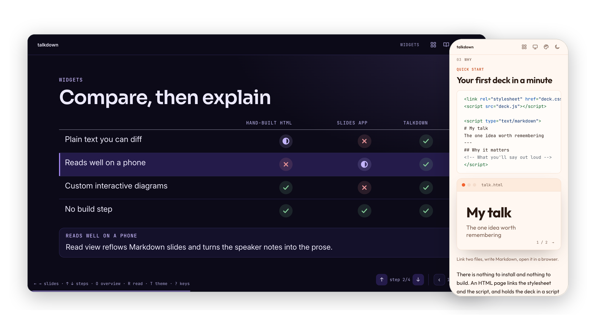
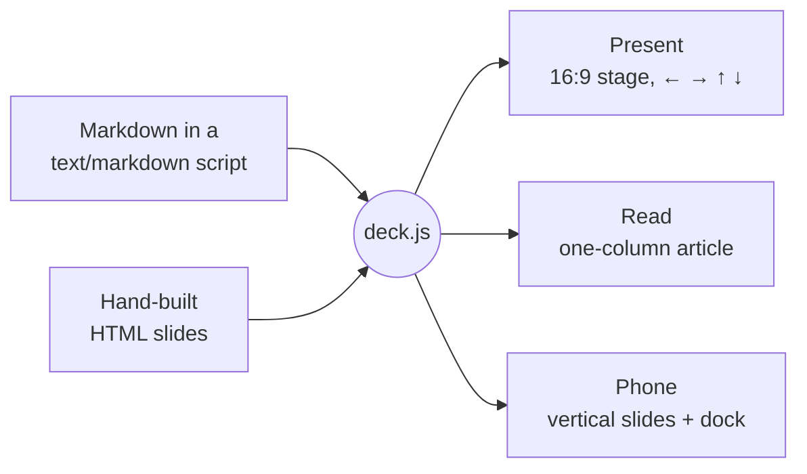
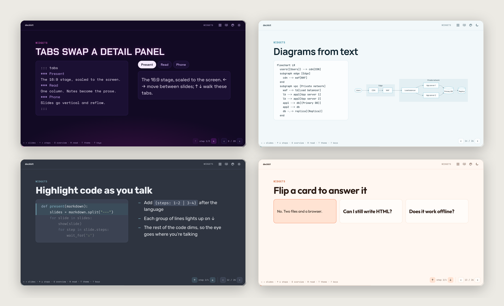
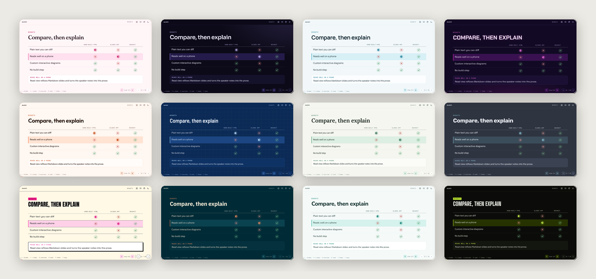
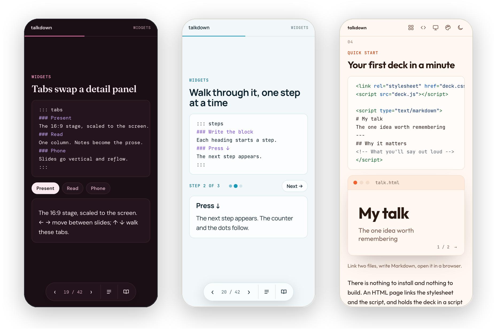

<div align="center">


# talkdown

**Interactive presentations in Markdown. Present as slides. Share as an article.**

Markdown an agent can write and you can edit · Themed interactive components · Escape hatches to HTML and JavaScript · No author build

[**Live demo**](https://sambhav.dev/talkdown/) &nbsp;·&nbsp; [**Widget gallery**](https://sambhav.dev/talkdown/gallery.html) &nbsp;·&nbsp; [Why](#why-talkdown) &nbsp;·&nbsp; [Quick start](#-quick-start) &nbsp;·&nbsp; [For agents](#-for-agents) &nbsp;·&nbsp; [Syntax](#-writing-slides) &nbsp;·&nbsp; [Widgets](#-widgets) &nbsp;·&nbsp; [Themes](#-themes) &nbsp;·&nbsp; [API](#-api)

    

<br>



</div>

<br>

## Why talkdown

Agents have gotten really good at building slides, and I make more and more of my talks that way. The results are great: interactive, quick to build, pretty, easy to iterate on with the agent, and easy to host as a static page.

But every deck is a pile of generated HTML:

- **Only an agent can maintain it.** The markup, styling and navigation are regenerated for every talk.
- **No two decks look the same.** Each one, and often each slide, invents its own layout and spacing.
- **A small edit means digging through markup.** Fixing a word or a number by hand is harder than it should be.
- **Every change burns tokens.** Even a typo goes back through the agent.

I also wanted things slide apps don't do, and agents only do with a lot of prompting:

- **Slides that work as a blog post**, so the link I share after a talk carries the whole idea, not just the bullets.
- **Themes** that restyle the whole deck at once.
- **Widgets** for technical talks: terminals, tables, charts, code walkthroughs and diagrams.
- **No build step, and nothing to host but static files.**

So I built talkdown:

- **Write Markdown, get interactive slides.** The agent writes only the content, so it uses far fewer tokens, and talkdown supplies the layout, theme, keyboard controls and phone layout, so every deck is consistent. The source is small enough to edit by hand.
- **One link, two formats.** Present it as slides. Afterwards, readers skim the slides or switch to an article where your speaker notes become the prose.
- **Themes and widgets built in.** 23 themes, each light and dark, and widgets that are a few lines of Markdown each.
- **Escape hatches when Markdown runs out.** Inline HTML, hand-built slides with your own JavaScript, CSS tokens, different words for slides and article, a small API, and a pinned or self-hosted runtime. Drop down for one slide; the rest stays Markdown.
- **No build, static hosting.** One HTML file and one script tag. GitHub Pages, a bucket or an intranet share all work.

The [live demo](https://sambhav.dev/talkdown/) is itself a talkdown deck: a short pitch, then a live tour of every feature. Use **← →** for slides and **↑ ↓** for steps; press **S** to see any slide's Markdown, **R** to read it as an article, and **T** for light or dark.

| To… | Start with… |
|---|---|
| See the pitch | [The opening presentation](https://sambhav.dev/talkdown/#why) |
| Explore live components | [Full widget gallery](https://sambhav.dev/talkdown/gallery.html) or [the widget tour](https://sambhav.dev/talkdown/#widgets) |
| Create a deck | [Quick start](#-quick-start) or [the starter file](examples/starter.html) |
| Have an agent write a deck | [For agents](#-for-agents) |
| Add a custom interaction | [HTML slides](#-html-slides) and [the API](#-api) |

## 🚀 Quick start

Create `talk.html`:

```html
<!DOCTYPE html>
<html lang="en">
<head>
  <meta charset="utf-8">
  <meta name="viewport" content="width=device-width, initial-scale=1">
  <title>Dynamic Tools</title>
  <script src="https://sambhav.dev/talkdown/latest.js"></script>
</head>
<body>
<script type="text/markdown">
layout: title
---
# Dynamic Tools

What happens when the tool you need arrives halfway through.

September 2026 · 15 minutes {.meta}

::: notes
These notes become the prose beneath this slide in read view.
:::

---
## One idea per slide

- Big type
- Short lines
- Press ↓ to step, → to move on
</script>
</body>
</html>
```

Open it in a browser and press →. The stable loader checks a fresh release manifest on every visit, then loads a matching pair of content-hashed JavaScript and CSS files. New Talkdown releases reach these decks on reload without editing their HTML.

<details>
<summary><b>Prefer to self-host?</b></summary>

<br>

Copy [`deck.css`](deck.css) and [`deck.js`](deck.js) next to your HTML and link them directly. [`examples/starter.html`](examples/starter.html) is a ready-made starting point. To publish, put the folder anywhere that serves static files: GitHub Pages, a bucket, an intranet share.

</details>

## Always use the latest runtime

For decks that should follow Talkdown updates, include this one stable URL:

```html
<script src="https://sambhav.dev/talkdown/latest.js"></script>
```

The loader itself can be cached. It requests `latest.json` with `cache: no-store` and a unique URL, then loads the named, integrity-checked JS/CSS pair. Those content-hashed files can be cached indefinitely. Every `npm run build` updates the manifest automatically; keep the older hashed files available for readers who already loaded a manifest.

This updates decks on a new visit or reload, not halfway through a presentation. It requires a network connection. While it loads, readers see a spinner in their light or dark mode; if the release can't be fetched or the runtime fails to start, they get an error screen with a Reload button instead of a blank page. Existing `deck.js` / `deck.css` links and offline authoring continue to work.

Custom JavaScript must wait for the asynchronous loader:

```html
<script>
Talkdown.onReady(Deck => {
  Deck.steps(document.getElementById('diagram'), 4, i => {
    // Render step i.
  }, { read: 'end' });
});
</script>
```

For a frozen, reproducible deck, copy both asset URLs and integrity values from a release's `latest.json` and link that exact pair instead. A mutable jsDelivr `@main` URL can serve cached code for hours, and browsers may retain it longer; it does not guarantee the latest runtime.

## Recommended choices for new decks

Use the quick start above for published decks that follow runtime updates. [`examples/starter.html`](examples/starter.html) keeps direct local runtime links for offline and self-hosted use; it demonstrates note blocks, tabs, and a chart backed by one Markdown table.

| Decision | Recommendation |
|---|---|
| A deck to share as one authored file | Embed Markdown and CSV in the HTML. No author build or HTTP server is needed with local runtime assets. |
| A code-heavy deck or content edited separately | Reference Markdown with `data-src` and serve over HTTP. This avoids closing-script-tag escaping in the source file. Keep media paths relative to the HTML wrapper. |
| Content that belongs in the talk and the article | Write full sentences in `::: notes`. Use `::: say` for delivery cues and `::: read` for article-only context. |
| A small hand-maintained dataset | Put a Markdown table inside `::: chart`. Keep the source once; the widget generates the plot, table, and CSV download. |
| Data copied from a spreadsheet or containing commas/newlines | Use a fenced `csv` block inside `::: chart`. Quote CSV cells normally; do not maintain a second table by hand. |
| Normal chart display | Omit `view` or use `view=auto`: plot first on stage, plot and table in the article. Use `view=both` when the audience needs the exact values during the talk. |
| Chart type | Use `bar`/`hbar` for categories, `line` for ordered trends, and `donut` for shares of one nonnegative series. Set `series="Column name"` explicitly for multi-column donut data. |
| Numbers and units | Use plain numeric cells, with units in the title/header. A percentage is `42` with `title="Share (%)"`, not a `42%` cell. Invalid or missing values need correction, not silent conversion to zero. |
| Layout and interaction | Choose a theme and built-in widgets first. Use `|||` sparingly, reveal steps only when they help the explanation, and reserve custom HTML/JS for a visual that needs it. |
| A published deck that should follow updates | Use the stable `latest.js` loader; it checks the current manifest on every visit. |
| A published deck that must stay reproducible | Link a matching content-hashed pair from a known release manifest, or pin both URLs to the same commit SHA. |

Always check desktop present view, phone-width read view, the chart's data table, and source copying before sharing. Optional fonts, diagrams, maths, icons, and recordings may require network access or self-hosted assets; a single authored HTML file does not automatically embed every resource.


### Additional visual chart types (experimental)

The same `::: chart` container now accepts `heatmap`, `scatter`, `bubble`, `waterfall`, `timeline`, `sankey`, `treemap`, and `range`. All use a Markdown table or fenced CSV as their single source of truth, with the existing Table/Both views and CSV export. These render as dependency-free SVG.

```md
::: chart type=heatmap title="Requests by hour"
| Day | 09:00 | 10:00 | 11:00 |
|---|---:|---:|---:|
| Mon | 12 | 22 | 45 |
| Tue | 16 | 31 | 58 |
:::

::: chart type=scatter x="Latency" y="Throughput" title="Latency vs throughput"
| System | Latency | Throughput |
|---|---:|---:|
| A | 80 | 950 |
| B | 110 | 820 |
:::

::: chart type=bubble x="Latency" y="Throughput" size="Users"
| System | Latency | Throughput | Users |
|---|---:|---:|---:|
| A | 80 | 950 | 20 |
| B | 110 | 820 | 50 |
:::

::: chart type=waterfall title="Latency improvements (ms)"
| Stage | Value | Kind |
|---|---:|---|
| Initial | 500 | total |
| Cache | -200 | change |
| Final | 300 | total |
:::

::: chart type=timeline title="Release roadmap"
| Task | Start | End |
|---|---|---|
| Design | 2026-10-01 | 2026-10-31 |
| Release | 2026-11-05 | |
:::

::: chart type=sankey title="Request routing"
| Source | Target | Value |
|---|---|---:|
| Requests | Tools | 600 |
| Requests | RAG | 300 |
:::

::: chart type=treemap title="Infrastructure spend"
| Path | Value |
|---|---:|
| Compute / GPU | 400 |
| Compute / CPU | 200 |
| Storage / Object | 150 |
:::

::: chart type=range title="Latency distribution (ms)"
| System | Min | Max | Median |
|---|---:|---:|---:|
| A | 30 | 180 | 85 |
| B | 70 | 310 | 140 |
:::
```

The renderer rejects invalid numbers, malformed rows, reversed ranges, negative Sankey flows, cycles, overlapping treemap paths, and invalid calendar dates. Visual charts accept up to 1,000 rows and 20,000 cells. Dense plots scroll within the figure on phones, with labels kept at their native size. The same scroll region is keyboard-focusable; Table/Both views and CSV export provide exact values without relying on hover.

| Type | Data and options |
|---|---|
| Heatmap | First column is the row label; every remaining column is numeric. Includes a colour scale. |
| Scatter / bubble | First column labels each point. `x` and `y` select exact header names (default: second and third columns). Bubble `size` defaults to the fourth column and controls circle **area**; it must be nonnegative. |
| Waterfall | First two columns are label and value. Optional `Kind` is `change` (default), `total`, or `subtotal`. A change adds to the running total; a total/subtotal sets it to the supplied absolute value. Green means increase and red means decrease. |
| Timeline chart | First column labels each row; `Start` is required, `End` is optional. Dates use valid `YYYY-MM-DD` calendar dates. Empty or absent End means a milestone. |
| Sankey | Required `Source`, `Target`, `Value` columns. Acyclic flows use a shared proportional width scale and distinct node ports. Negative flows and all-zero datasets are rejected. |
| Treemap | First column contains slash-separated paths; `Value` is required. Values are nonnegative with a positive total. Paths cannot be duplicated or overlap a parent and child. Uses alternating proportional slices. |
| Range | First column labels each row; `Min` and `Max` are required. Optional `Median` must lie inside the range and appears as a dot. |

Column names are case-sensitive. Unsupported options produce a diagnostic instead of being silently ignored. Sankey and treemap remain lightweight layouts rather than full layout-engine replacements.

## 🤖 For agents

Give your agent one URL and it learns the whole format:

```
https://sambhav.dev/talkdown/skills/talkdown/SKILL.md
```

The same file is on the CDN at `https://cdn.jsdelivr.net/gh/sambhav/talkdown@main/skills/talkdown/SKILL.md`, and [`llms.txt`](https://sambhav.dev/talkdown/llms.txt) is the short index for tools that look for one.

A prompt that works:

> Read https://sambhav.dev/talkdown/skills/talkdown/SKILL.md and make me a 10-slide talkdown deck about how our cache invalidation works. Put what you'd say in speaker notes so it also reads as an article.

**In Claude Code**, copy the [`skills/talkdown`](skills/talkdown) folder into `~/.claude/skills/` (or a project's `.claude/skills/`) and ask for a talkdown deck. It loads when needed.

## 🧭 How it works



`deck.js` turns each Markdown script into ordinary `<section class="slide">` elements, next to any you wrote by hand. Present view scales them onto a 1280×720 stage. Read view lays the same elements out as an article, so nothing is rendered twice. Widgets register as **steppers**: ↓ advances the first unfinished stepper on the slide, then moves to the next slide.

## ✍️ Writing slides

```md
---
kicker: Results
build: true
---
## Latency fell by half

|||

- p50: 180 ms → 90 ms
- p99: 1.2 s → 480 ms {.step}

|||

::: card
**What changed:** the cache moved to the edge.
:::

::: say
Walk through p50 first, then reveal p99.
:::
```

| Syntax | Effect |
|---|---|
| `---` | Starts a new slide |
| `key: value` lines between two `---` | Frontmatter for the next slide |
| `::: notes` … `:::` | Markdown shared between speaker notes and article prose |
| `::: say` … `:::` · `::: read` … `:::` | Speaker-only notes · article-only prose |
| `\|\|\|` | Starts a column. Text before the first one spans the slide |
| `::: name` … `:::` | Wraps blocks in `<div class="name">`. Containers nest. `::: grid` makes balanced rows |
| `{.step}` | Reveals that block on ↓ |
| `{.class #id}` | Adds a class or id. On its own line, applies to the block above |
| `==text==` | Accent-coloured text |
| `[text](#id)` | Links to the slide with that `id` |
| `::: present-only` · `::: read-only` | Content for one format only. See [One deck, two formats](#one-deck-two-formats) |

Markdown is tokenized by bundled markdown-it, with talkdown extensions for slides, containers, notes, and widgets. `---` is reserved for slide boundaries, so use `#` headings rather than Setext underlines. Inline HTML passes through; decks should contain trusted author content.

### One HTML file, no author build

For a new single-file deck, put your content in `index.html`, link `deck.js` and `deck.css`, and open it. No install, build, or separate Markdown file is required. CDN assets require a connection; local copies of the two runtime files keep the core deck available offline. Local copies of the script and stylesheet also work from `file://`.

Inside an embedded Markdown script, write `<\/script>` instead of a literal closing script tag inside the Markdown script. **S → Copy** preserves that escape so the result can be pasted back into the HTML safely.

Markdown, CSV data, HTML slides and custom JavaScript can all stay in that one HTML file. The tokenizer and CSV decoder are already bundled into `deck.js`; no additional script tags or per-deck generated files are needed.

To reference a Markdown file instead of embedding it, use:

```html
<script type="text/markdown" data-src="talk.md"></script>
```

Serve referenced decks over HTTP; direct `file://` use remains supported for inline decks. You can mix references, inline Markdown, and hand-written HTML slides in document order. Relative image and recording URLs resolve against the HTML wrapper. A failed reference displays an error without preventing the other slides from loading.

- Escape punctuation in prose with a backslash: `\*literal asterisks\*`.
- Use two backticks around inline code that contains one backtick, and a longer matching fence around fenced code examples.
- Pipes inside code spans stay within one table cell; use `\|` for a literal pipe elsewhere in a table.
- Fenced code preserves comments, footnote definitions, slide separators, and widget delimiters as literal examples.

<details>
<summary><b>Frontmatter keys</b></summary>

<br>

| Key | Values |
|---|---|
| `layout` | `title`, `section`, `statement`, `center` or `default` |
| `section` | Shown in the top bar. It carries over until changed; a `section` slide sets it to its heading |
| `kicker` | A small label above the heading |
| `build` | `true` reveals each block after the heading, and each list item, one step at a time |
| `id` | A name for deep links (`#id`) and slide links (`[text](#id)`) |
| `class` | Extra classes on the slide |
| `name` | The slide's name in the overview. Defaults to its first heading |
| `takeaway` | One line shown above the speaker notes |
| `read` | `hide` leaves the slide out of the article. `text` shows only its prose in the article, not the slide |
| `present` | `hide` makes an article-only slide: skipped when presenting |
| `image` | A background picture. With `layout: image`, the text sits over it on a dark scrim |

</details>

## 🧩 Widgets



Widgets use a few lines of Markdown. Stateful widgets take part in ↑ ↓ navigation and expand in read view; charts follow their `view` setting.

| Widget | Write |
|---|---|
| **Tabs** | `::: tabs`, then a `###` heading per tab. `::: toggle` is the same, styled as a switch |
| **Walkthrough** | `::: steps`, then a `###` heading per step. Adds a counter, progress dots and Next |
| **Explained table** | `{.explain}` after a table. The last column becomes the detail for the selected row |
| **Marks** | ✓ ◐ ✗ at the start of a cell become icons in the theme's green, accent and red |
| **Stepped code** | ` ```python {steps: 1-2 \| 3-4} ` lights up each group of lines in turn |
| **Copy buttons** | Every code block gets a **Copy** button, shown on hover and always on touch screens |
| **Flip cards** | `::: flip`: the `###` heading is the front, the rest is the back |
| **Timeline** | `::: timeline`, then a `###` heading per milestone. Vertical on phones |
| **Stats** | `::: stats` around a list like `- **42%** faster first response` |
| **Callouts** | `> [!NOTE]`, `[!TIP]`, `[!WARNING]`, `[!IMPORTANT]`, `[!CAUTION]` |
| **Diagrams** | ` ```mermaid `: flowcharts, networks, sequence, architecture, state, charts and more. Add `{source}` to show the text beside it. Readers can click a diagram to open it full screen and zoom |
| **Charts** | `::: chart type=line` around a table or fenced CSV. Plot, table and download share one dataset. Legacy `{.chart}` table attributes still work |
| **Pull quotes** | A `>` quote whose last line starts with `—` becomes a large quote with that attribution |
| **Checklists** | `- [x] done` and `- [ ] to do` |
| **Footnotes** | `text[^1]` and a `[^1]: source` line anywhere on the slide; set small at its foot |
| **Maths** | `$x^2$` inline or a `$$ … $$` block, typeset by [KaTeX](https://katex.org/) |
| **Image slides** | `layout: image` and `image: path.jpg` in the frontmatter: a full-bleed picture with the text over it |
| **Terminal** | A ` ```terminal ` block: each `$ command` line types out on ↓, and the lines after it are its output |
| **Recordings** | `` plays an [asciinema](https://asciinema.org/) recording in the same window, without the asciinema player. A file needs the page served over http; paste the recording into a ` ```cast ` block to play it anywhere |
| **Video** | `` embeds a player |
| **Accordion** | `::: accordion`, then a `###` heading per item; ↓ opens them in turn |
| **Feature cards** | `::: features`, then a `###` heading per card. An `:icon:` or image at the start of the heading becomes its icon. Up to three per row; set `--n` on `.w-features` for more |
| **Agenda** | An empty `::: agenda` lists every section slide, each linking to it |
| **QR code** | `::: qr` draws a QR code of the deck's link, or of a URL written inside it |
| **Icons** | `:rocket:` anywhere: any of the [Lucide](https://lucide.dev/icons) icons, drawn in the theme's colours. A feature card's heading can also start with `` |

```md
::: tabs
### Present
The 16:9 stage, scaled to the screen.
### Read
One column. Notes become the prose.
:::
```

<details>
<summary><b>Code highlighting, diagrams and maths</b></summary>

<br>

Fenced code is highlighted by [highlight.js](https://highlightjs.org/), [Mermaid](https://mermaid.js.org/) draws diagrams, and [KaTeX](https://katex.org/) typesets maths. Both use the theme's colours and fonts, and redraw when the theme or mode changes. Each library, and the QR code generator, and icons, is fetched from jsDelivr only if the deck needs it. To self-host one or turn it off:

```html
<html data-highlight="/vendor/highlight.min.js" data-diagrams="off" data-math="off">
```

With diagrams off, or offline, the Mermaid source is shown instead.

</details>

### Charts, data tables and CSV

````md
::: chart type=line title="Median latency (ms)"
```csv
Quarter,Before,After
Q1,180,90
Q2,160,80
Q3,140,70
```
:::
````

You can put a Markdown table inside the container instead of CSV. The first column contains labels; remaining columns contain numeric series. CSV supports quoted commas, doubled quotes, multiline cells, BOM, LF and CRLF. Numeric cells accept decimals and scientific notation; missing values, currency symbols and percentages produce visible row/column errors instead of silently becoming zero. Keep units in the title. Bar, horizontal bar and line charts support signed values. Donuts require nonnegative values with a positive total; choose `series="After"` when the input has multiple numeric columns.

| Option | Values |
|---|---|
| `type` | `bar` (default), `hbar`, `line`, `donut` |
| `view` | `chart`, `table`, `both`, `auto` (default: chart when presenting, both in the article) |
| `title` | A quoted caption, such as `title="Median latency (ms)"` |
| `series` | Plot one named numeric column |

Every chart has a keyboard-accessible view selector and a **Download CSV** button. Explicit `view=both` puts the chart and table side by side on desktop slides and stacks them on phones. Data tables scroll within the widget; the first 200 rows are displayed and the download includes every row. Charts accept up to 1,000 rows and 50 numeric columns, with up to six plotted series. Invalid data remains inspectable. Formula-like text is escaped in CSV downloads for spreadsheet safety.

Native HTML uses the same component:

```html
<figure data-chart="line" data-chart-view="both">
  <figcaption>Median latency (ms)</figcaption>
  <table>
    <thead><tr><th>Quarter</th><th>Before</th><th>After</th></tr></thead>
    <tbody><tr><th>Q1</th><td>180</td><td>90</td></tr></tbody>
  </table>
</figure>
```

Place it inside a slide's `.content`. The native table remains useful before enhancement; `Deck.chart(element)` can enhance a chart added later by custom JavaScript.

## 🎨 Themes



Themes apply across slides and built-in components, including charts, code highlighting, callouts and diagrams. One attribute picks the look:

```html
<html lang="en" data-theme="rose">
```

| | |
|---|---|
| **Everyday** | `clean` (default) · `paper` · `slate` · `ledger` · `noir` ☾ |
| **Editorial & craft** | `editorial` · `swiss` · `atelier` · `mocha` |
| **Warm & friendly** | `rose` · `sunset` · `chalk` ☾ · `clinic` |
| **Nature & calm** | `forest` · `ocean` · `nord` ☾ |
| **Tech** | `solar` ☾ · `terminal` ☾ · `ai` ☾ · `blueprint` ☾ |
| **Loud** | `punk` · `volt` ☾ · `synth` ☾ |

Every theme is a light and dark pair; ☾ marks the ones designed dark first, and the picker shows the same mark. Decks open in the viewer's system light or dark mode; `<html data-mode="light">` or `"dark"` fixes the default. Viewers switch with **T**, and their choice is remembered.

- `?theme=rose` and `?mode=dark` in the URL override both. Handy for sharing.
- `<html data-theme="paper" data-theme-dark="clean">` opens in paper for light-mode viewers and clean for dark-mode ones, and **T** switches between them (until the viewer picks a theme).
- `<html data-theme-picker>` adds a picker to the top bar so viewers can choose.
- Typefaces load from Google Fonts for the active theme only. `<html data-fonts="off">` keeps system fonts.

<details>
<summary><b>Make your own</b></summary>

<br>

Every colour, typeface and size is a CSS custom property. Override them after `deck.css`:

```css
:root {
  --accent: #F1B000; --accent-soft: #FFF3CC; --on-accent: #161514; --accent-ink: #8D6700;
  --sans: "Space Grotesk", system-ui, sans-serif;
}
[data-mode=dark] { --accent: #FFC94D; --accent-ink: #F5C542; }
```

| Token | Use |
|---|---|
| `--bg` `--surface` `--surface-2` `--line` | Background, cards, insets, hairlines |
| `--fg` `--muted` | Text and secondary text |
| `--faint` | Decorative lines and dots, never text |
| `--accent` `--accent-soft` `--on-accent` | Accent, its tint, and text on an accent fill |
| `--accent-ink` | The accent as text: links, kickers, highlights |
| `--inv` `--on-inv` `--inv-muted` | Inverted blocks (`.card.inv`) and their text |
| `--red` `--green` `--blue` `--orange` | Status colours, used by callouts, marks and diagrams |
| `--mark-yes` `--mark-part` `--mark-no` | ✓ ◐ ✗ colours |
| `--chart-1` … `--chart-6` | Chart series colours. Default to the accent, then the theme's code and status colours |
| `--c-key` `--c-str` `--c-com` `--c-num` `--c-fn` `--c-type` `--c-tag` | Code highlighting |
| `--sans` `--display` `--mono` | Body, heading and mono typefaces |
| `--grid` | A colour draws a background grid; `transparent` turns it off |
| `--t-title` `--t-h2` `--t-body` … | The type scale. Read view and phone slides redefine it |

</details>

## 🎤 Presenting

| Key | |
|---|---|
| `←` `→` `Space` | Previous / next slide |
| `↑` `↓` `Enter` | Previous / next step, then on to the next slide |
| `1`–`9` | Jump to a step on this slide |
| `R` | Read view ⇄ present view |
| `T` | Light ⇄ dark |
| `O` · `N` · `F` · `?` | Overview · speaker notes · fullscreen · all keys |
| `P` | Presenter view: a second window with the next slide, your notes and a timer, kept in step with the audience screen |
| `L` · `D` | Laser pointer · draw on the slide (cleared on the next slide) |
| `S` | Show the current slide's Markdown (view source) |
| Click a diagram | Open it full screen: scroll or pinch to zoom, drag to move, `Esc` to close |
| Click a link to a slide | Jumps there; the browser's Back button returns to the slide you were on |

On phones, the default is slides. A compact row of **Previous**, **Next**, and **Menu** buttons stays available near the bottom. The menu contains **Slides / Article**, **Home**, and a section/slide picker. Opening it does not resize the content.

- The floating arrows advance or reverse the current step. After the last step, Next changes slides.
- Tabs, walkthroughs, code highlights, terminal examples and reveal builds all use those same arrows. No extra inline navigation bars are added. Existing widget controls still work.
- Choose **Article** for normal page scrolling; its arrows jump between entries. Switching views keeps your place.
- Long slides scroll vertically; wide code blocks and tables scroll horizontally.
- Browser scrolling, text selection, zoom, and back/forward gestures keep their normal behaviour. There is no custom swipe or edge-tap navigation.
- Buttons have 48 CSS-pixel touch targets, accessible names, and visible keyboard focus. The primary buttons are separated by 8px.

These choices follow [Apple's gesture guidance](https://developer.apple.com/design/human-interface-guidelines/gestures) and [Google's touch-target guidance](https://support.google.com/accessibility/android/answer/7101858?hl=en): familiar interaction and explicit controls.

Switching to the article shows the complete explanation. Switching back restores your presenter step. Rotating the phone keeps the selected view.

## 📱 Reading



Tap the floating navigation button and choose **Article**, or press **R** on a laptop:

- Markdown slides reflow into article typography, with a chapter label on each.
- **Speaker notes become the prose.** Timing cues like `[~60s]` are dropped.
- Builds and widgets show everything.
- Hand-built slides become figures with a **Present** button.

### One deck, two formats

Presenting and reading want different things, so you control each separately:

| Write | Presenting | Article |
|---|---|---|
| `::: notes` … `:::` | Speaker notes | Prose under the slide |
| `::: say` … `:::` | Speaker notes | Left out |
| `::: read` … `:::` | Left out | Prose under the slide |
| `::: present-only` … `:::` | Shown | Left out |
| `::: read-only` … `:::` | Left out | Shown |
| `read: hide` in frontmatter | Shown | The slide is left out |
| `read: text` in frontmatter | Shown | Only its prose, not the slide |
| `present: hide` in frontmatter | Skipped | Shown: an article-only section |

`{.present-only}` and `{.read-only}` do the same for a single block, and work in HTML slides too.

```md
---
read: text
---
## Cache hit rate


::: say
Pause here and ask who has seen this graph.
:::

::: read
The hit rate rose from 61% to 94% once the cache moved to the edge.
:::
```

Present view works on phones too. Held upright, slides go vertical and reflow at the phone's width, and speaker notes hide until you tap the notes button. Share an article link with `?view=read`, or slides with `?view=present`; append a slide id such as `#widgets` to open that section. Slides are the default on every screen. Authors can set `<html data-view="present">` or `<html data-view="read">` to choose a default for every screen.

## 🛠 HTML slides

When a slide needs something Markdown can't express, write it by hand, anywhere between Markdown blocks:

```html
<section class="slide" data-section="Architecture" data-name="The pipeline">
  <div class="content">
    <h2>How a request flows</h2>
    <div id="pipe">…</div>
    <button data-next></button>
  </div>
  <aside class="notes">What to say over this slide.</aside>
</section>

<script>
  Talkdown.onReady(Deck => {
    Deck.steps(document.getElementById('pipe'), 4, i => {
      // draw step i; ↑ ↓, the step counter and the URL all follow along
    }, { read: 'end' });   // show the last step in read view
  });
</script>
```

Add the class `flow` if the slide can reflow in read view; otherwise it is shown as a scaled figure. A slide can have several steppers. `<div data-build>` with `[data-step]` children and `<button data-next>` work without any script.

### Your own top bar

The top bar shows `document.title`, the current section and the deck's buttons. To use your own name or add links, put a `#bar` anywhere in the page:

```html
<div id="bar">
  <div class="title">My talk</div>
  <a href="https://github.com/you/repo">GitHub</a>
</div>
```

Links show as small pills beside the title, and talkdown still adds the section label and buttons. There is no footer slot.

## 📚 API

| | |
|---|---|
| `Deck.steps(el, n, show, { read })` | Register a stepper. `show(i)` renders step `i` |
| `Deck.tabs(container, onPick)` | Make each button in a container a step |
| `Deck.go(i, step?)` · `Deck.next()` · `Deck.prev()` | Move the deck |
| `Deck.cur` · `Deck.slide` · `Deck.slides` | Current index, current slide, all slides |
| `Deck.on('slide', (slide, i) => …)` | Runs when the slide changes |
| `Deck.on('ready', () => …)` | Runs once Markdown slides exist |
| `Deck.key('d', e => …)` | Bind a key |
| `Deck.setView('read' \| 'present')` | Switch views |
| `Deck.markdown(text)` | Render Markdown to HTML |
| `Deck.chart(element)` | Enhance a chart container added by custom JavaScript |
| `Deck.store.get(k, fallback)` · `.set(k, v)` | localStorage, namespaced `talkdown:` |

## Compatibility with existing decks

Existing public `deck.js` and `deck.css` URLs on jsDelivr and sambhav.dev remain supported. Keep using the same two root asset paths; there is no required `dist/` path or additional parser script.

| Existing syntax | Supported behavior | Prefer for new content |
|---|---|---|
| `<!-- … -->`, `<!-- say: … -->`, `<!-- read: … -->` | Comment-based shared/speaker/article notes | `::: notes`, `::: say`, `::: read` blocks |
| A table followed by `{.chart .line}` (or `.hbar`, `.donut`) | Legacy chart conversion | `::: chart type=line` around the dataset |
| Formatted values in legacy `{.chart}` tables, such as `42%` or `$1,200` | Lenient numeric conversion for old decks | Plain numeric cells and units in captions for new chart containers |
| A multi-series legacy donut | Plots its first numeric column | Select the intended column with `series="Column name"` |

Ordinary attributes such as `{.step}`, `{.explain}`, and `{.class #id}` remain current syntax; only the old chart shorthand is discouraged for new charts.

## 🌐 Browser support

Current Chrome, Edge, Firefox and Safari, on desktop and mobile. Print from the browser for a PDF with one slide per page and every build shown.

## 🤝 Contributing

Deck authors never build anything: use `latest.js`, or local `deck.js` and `deck.css` for offline decks. Maintainers edit `deck.css` directly and the JavaScript in `src/`, then run `npm ci`, `npm run build` and `npm test`. Commit the rebuilt `deck.js`, `latest.json`, and new `dist/deck.<hash>.js` / `.css` assets. Keep previous hashed assets available. CI checks the committed bundle and manifest against a fresh build.

For browser checks, run `npx playwright install chromium`, then `npm run test:single-file` and `node tests/run-browser.cjs`. The browser suite covers the full demo, phone layouts, CSV and Markdown table equivalence, view switching, downloads, invalid data, native HTML charts, notes and keyboard controls.

talkdown is pre-release (0.3.0), so the syntax may still change before 1.0.


## License

[MIT](LICENSE) © Sambhav Kothari

